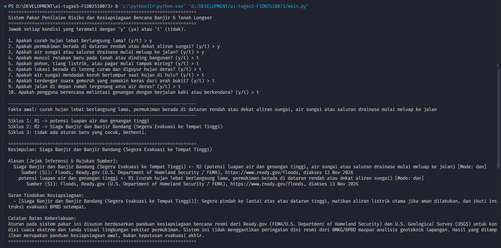
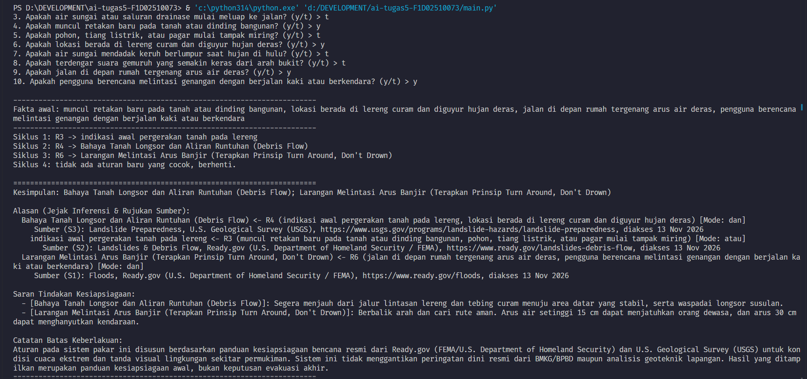
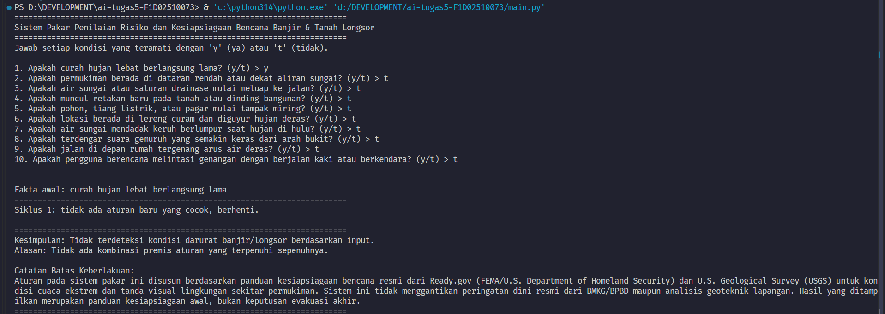

# Sistem Pakar Penilaian Risiko dan Kesiapsiagaan Bencana Banjir & Tanah Longsor

## 1. Identitas Mahasiswa
* **Nama:** Maulidar Ihlas
* **NIM:** F1D02510073
* **Mata Kuliah:** Kecerdasan Buatan (MKL1303131)

## 2. Topik dan Cara Menjalankan Program
* **Topik:** Penilaian Risiko dan Kesiapsiagaan Bencana Banjir dan Tanah Longsor
* **Bahasa & Versi:** Python 3.8 atau lebih baru (menggunakan *standard library* `json` dan `os`, tanpa dependensi eksternal).
* **Struktur Direktori:**
  ```text
  ai-tugas5-NIM/
  ├── kb_bencana.json
  ├── sistem_pakar_bencana.py
  ├── README.md
  └── screenshot/
      ├── kasus1_siaga_banjir.png
      ├── kasus2_longsor_arus.png
      └── kasus3_negatif.png
  ```
* **Cara Menjalankan:**
  1. Pastikan file `sistem_pakar_bencana.py` dan `kb_bencana.json` berada dalam satu direktori yang sama.
  2. Buka terminal atau Command Prompt pada direktori tersebut, lalu jalankan perintah:
     ```bash
     python sistem_pakar_bencana.py
     ```
  3. Jawab setiap pertanyaan kondisi lingkungan yang muncul dengan `y` (ya) atau `t` (tidak).

## 3. Daftar Sumber dan Tabel Aturan

### Daftar Sumber
* **S1:** *Floods*, Ready.gov (U.S. Department of Homeland Security / FEMA), https://www.ready.gov/floods, diakses 13 Nov 2026.
* **S2:** *Landslides & Debris Flow*, Ready.gov (U.S. Department of Homeland Security / FEMA), https://www.ready.gov/landslides-debris-flow, diakses 13 Nov 2026.
* **S3:** *Landslide Preparedness*, U.S. Geological Survey (USGS), https://www.usgs.gov/programs/landslide-hazards/landslide-preparedness, diakses 13 Nov 2026.

### Tabel Aturan IF-THEN
| ID | Premis (IF) | Mode | Akibat (THEN) | Jenis Output | Sumber |
| :--- | :--- | :---: | :--- | :---: | :---: |
| **R1** | `curah hujan lebat berlangsung lama` **AND** `permukiman berada di dataran rendah atau dekat aliran sungai` | `dan` | `potensi luapan air dan genangan tinggi` | Fakta Antara | S1 |
| **R2** | `potensi luapan air dan genangan tinggi` **AND** `air sungai atau saluran drainase mulai meluap ke jalan` | `dan` | `Siaga Banjir dan Banjir Bandang (Segera Evakuasi ke Tempat Tinggi)` | Kesimpulan | S1 |
| **R3** | `muncul retakan baru pada tanah atau dinding bangunan` **OR** `pohon, tiang listrik, atau pagar mulai tampak miring` | `atau` | `indikasi awal pergerakan tanah pada lereng` | Fakta Antara | S2 |
| **R4** | `indikasi awal pergerakan tanah pada lereng` **AND** `lokasi berada di lereng curam dan diguyur hujan deras` | `dan` | `Bahaya Tanah Longsor dan Aliran Runtuhan (Debris Flow)` | Kesimpulan | S3 |
| **R5** | `air sungai mendadak keruh berlumpur saat hujan di hulu` **OR** `terdengar suara gemuruh yang semakin keras dari arah bukit` | `atau` | `Peringatan Dini Aliran Bandang Lumpur Hulu (Wajib Menjauh dari Lembah Sungai)` | Kesimpulan | S3 |
| **R6** | `jalan di depan rumah tergenang arus air deras` **AND** `pengguna berencana melintasi genangan dengan berjalan kaki atau berkendara` | `dan` | `Larangan Melintasi Arus Banjir (Terapkan Prinsip Turn Around, Don't Drown)` | Kesimpulan | S1 |

## 4. Metode Penalaran yang Dipilih
Program ini menggunakan metode **Forward Chaining (FC)**. Penalaran dimulai dari fakta gejala cuaca dan tanda visual fisik lingkungan yang diamati secara langsung oleh pengguna di lapangan (*data-driven*). Mesin inferensi mencocokkan fakta awal terhadap premis aturan secara berulang per siklus untuk menurunkan fakta antara (`R1`, `R3`) hingga mencapai kesimpulan kesiapsiagaan akhir (`R2`, `R4`, `R5`, `R6`) beserta jejak aturan (*explanation facility*) dan referensi sumbernya.

## 5. Tiga Kasus Uji dan Screenshot

| # | Jawaban "ya" (`y`) | Kesimpulan yang Diharapkan |
| :-: | :--- | :--- |
| **1** | `curah hujan lebat berlangsung lama`, `permukiman berada di dataran rendah atau dekat aliran sungai`, `air sungai atau saluran drainase mulai meluap ke jalan` | **Siaga Banjir dan Banjir Bandang (Segera Evakuasi ke Tempat Tinggi)** (melalui rantai `R1 -> R2`) |
| **2** | `muncul retakan baru pada tanah atau dinding bangunan`, `lokasi berada di lereng curam dan diguyur hujan deras`, `jalan di depan rumah tergenang arus air deras`, `pengguna berencana melintasi genangan dengan berjalan kaki atau berkendara` | **Bahaya Tanah Longsor dan Aliran Runtuhan (Debris Flow)** (`R3 -> R4`) dan **Larangan Melintasi Arus Banjir** (`R6`) |
| **3** | `curah hujan lebat berlangsung lama` saja | **Tidak ada kesimpulan** (kasus negatif) |

### Screenshot Eksekusi Program

**Kasus Uji 1 (Positif — Siaga Banjir via R1 -> R2):**


**Kasus Uji 2 (Positif — Bahaya Longsor via R3 -> R4 dan Larangan Melintasi Arus via R6):**


**Kasus Uji 3 (Negatif — Tidak Ada Kesimpulan):**


## 6. Batas Keberlakuan
Aturan pada sistem pakar ini disusun berdasarkan panduan kesiapsiagaan bencana resmi dari Ready.gov (FEMA/U.S. Department of Homeland Security) dan U.S. Geological Survey (USGS) untuk kondisi cuaca ekstrem dan tanda visual lingkungan sekitar permukiman. Sistem ini tidak menggantikan peringatan dini resmi dari BMKG/BPBD maupun analisis geoteknik lapangan. Hasil yang ditampilkan merupakan panduan kesiapsiagaan awal bagi masyarakat, bukan keputusan evakuasi akhir.

## 7. Penggunaan Alat Bantu AI
Tugas ini disusun dengan bantuan alat bantu AI (Gemini) untuk perancangan struktur basis pengetahuan JSON, penulisan kode mesin inferensi Forward Chaining dalam bahasa Python, serta penyusunan dokumentasi README. Seluruh isi sumber rujukan, aturan logika, kode program, dan skenario pengujian telah dipahami serta diverifikasi secara mandiri.